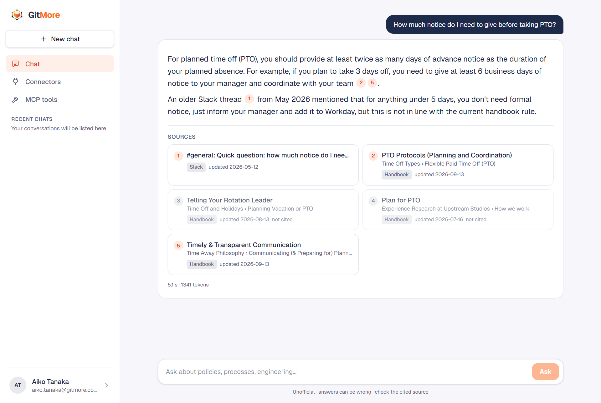
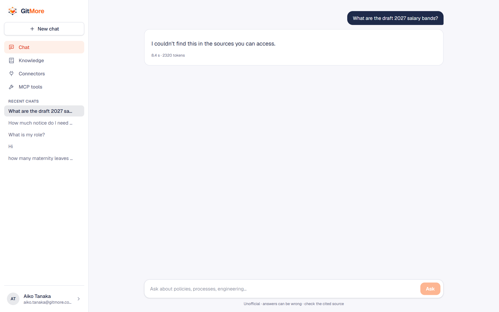
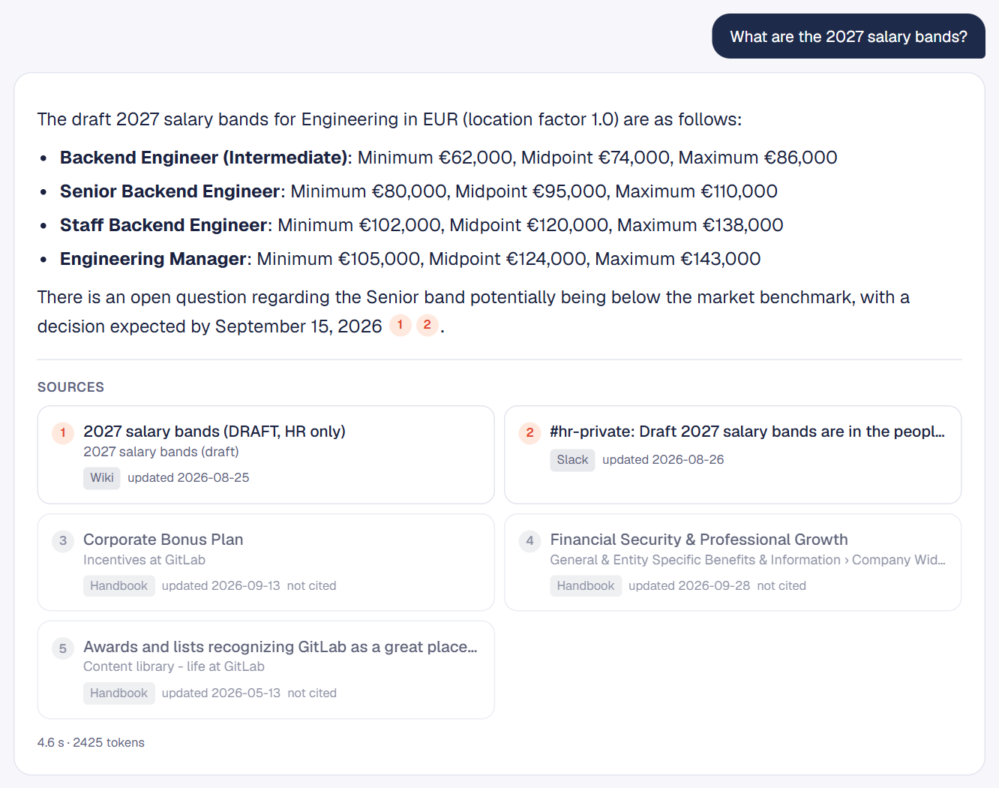
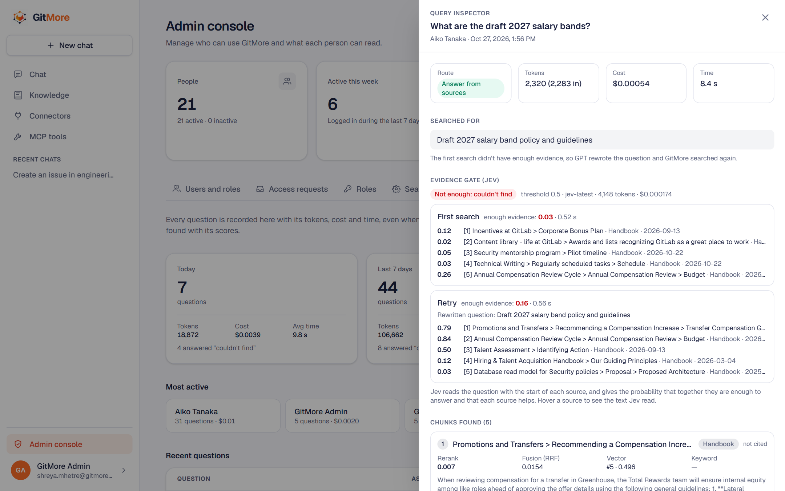
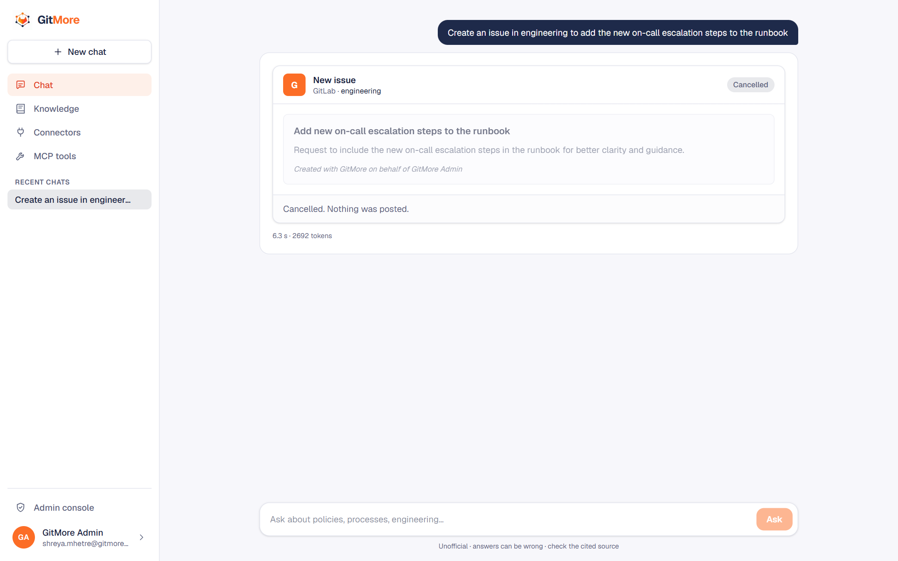
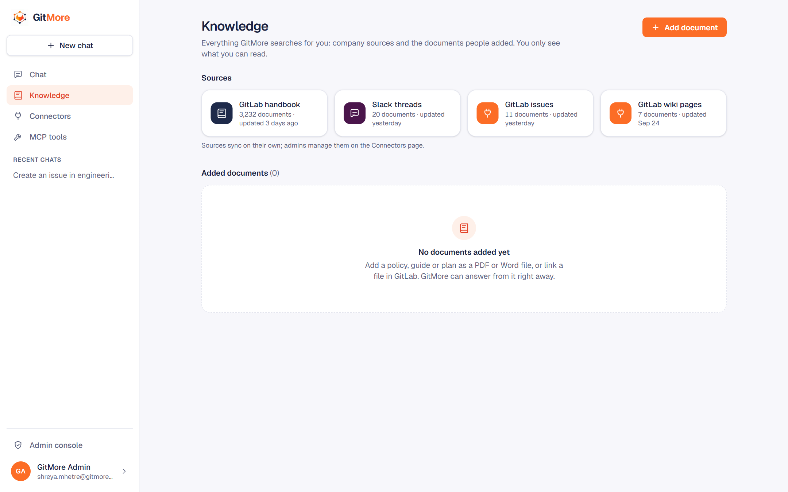
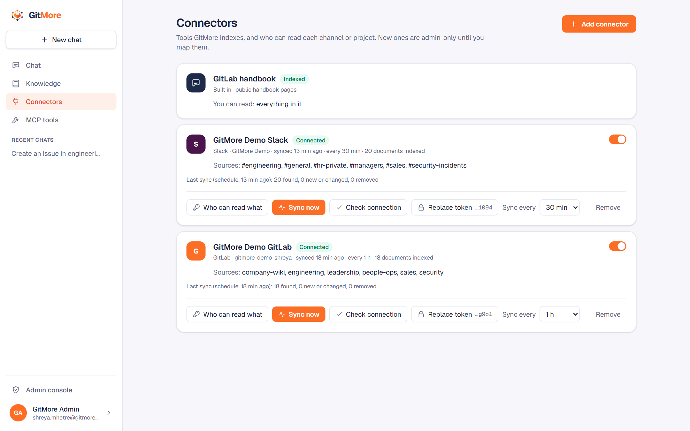
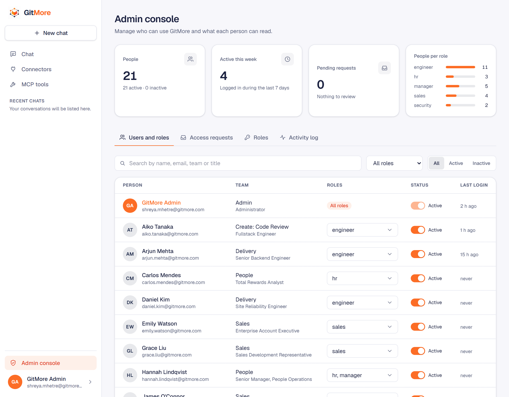
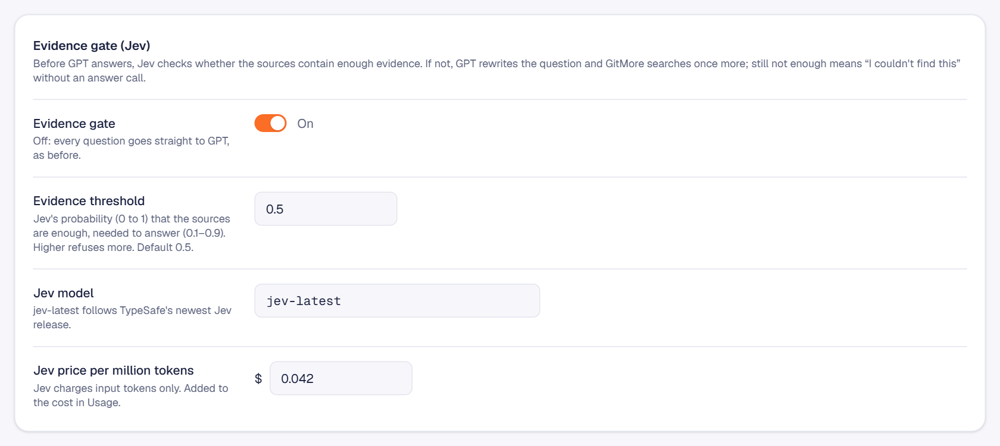

<div align="center">

<picture>
  <source media="(prefers-color-scheme: dark)" srcset="assets/brainbase-wordmark-dark.svg">
  
</picture>

**A configurable foundation for company intelligence.**

Connect company knowledge. Retrieve with evidence. Respect permissions. Enable AI-powered workflows.

[Meet GitMore](#meet-gitmore) · [Architecture](#architecture) · [Demo](#demo) · [Evaluation](#evaluation) · [Run locally](#run-locally)

</div>

---

## The problem

Company knowledge rarely lives in one place. It is spread across repositories, handbooks, issue trackers, chat threads, documents, and internal tools.

People waste time searching, repeat questions, and struggle to tell which source is authoritative. A unified assistant introduces another challenge: **it must never expose information a person is not allowed to see.**

## The idea

**BrainBase is a configurable foundation for building company-specific AI brains.**

Most internal assistants are built once, for one company, with its sources, rules and prompts written into the code. Every new team, tool or permission rule then means another code change. BrainBase takes the opposite approach: the pipeline is fixed and well tested, and everything that differs between companies is configuration, managed by admins in the app.

**What stays the same for every company**

- **Ingestion:** content is fetched, cleaned, split into chunks along its headings, embedded, and stored with its metadata and the roles allowed to read it. Unchanged content is never processed twice.
- **Retrieval:** vector and keyword search run together, their results are fused and reranked, and access rules are applied inside the search itself, so restricted text never reaches the model.
- **Evidence before answers:** a separate model checks whether the sources actually contain the answer. If not, the question is rewritten and searched once more; if there is still nothing, the person is told so instead of getting a guess.
- **Grounded answers:** every claim is cited, newer official policy wins over older chat messages, and conflicts are named rather than merged.
- **Controlled actions:** requests like "create an issue" or "post this in Slack" become a draft the person reviews, rechecked and recorded when they confirm.
- **Measurement:** every message is traced, logged with its cost, and inspectable; evaluation scripts check retrieval quality and that no one sees what they shouldn't.

**What each company configures**

- **Sources:** which tools to connect (handbooks, Slack, GitLab, uploaded documents) and how often they sync.
- **People and access:** roles, who holds them, and which roles can read each channel, project or document. New sources are closed until someone maps them.
- **Tools:** which actions are available, through which MCP servers, and for which roles.
- **Search and answers:** how deep to search, which model answers, how long answers are, and how strict the evidence gate is.

The result is one foundation that can power many company brains, each shaped by configuration rather than custom code.

## Meet GitMore

<div align="center">


</div>

**GitMore is BrainBase's reference implementation: a company brain for the GitLab ecosystem.**

GitMore shows what a BrainBase deployment looks like for a real-world style company. It brings together the public GitLab handbook, GitLab projects, issues and wiki pages, Slack conversations, and documents people upload, behind one chat and one admin console. Synthetic internal content (draft salary bands, a managers-only restructuring plan, a security incident, an outdated Slack answer) is included on purpose, so permissions and conflicting answers can be demonstrated safely.

**GitMore is an independent project built around GitLab's public handbook and tools. It is not an official GitLab product.**

## What GitMore does

**Ask and get cited answers**
- Chat with streamed answers and clickable `[n]` citations that open the original page, thread, issue or file.
- Follow-up questions understood in context; saved conversations in the sidebar.
- Small talk handled politely; questions about the company are always answered from sources, never from memory.
- Older or conflicting sources are named ("an older Slack thread said…") instead of silently merged.

**See only what you're allowed to see**
- Roles per person, access mapping per Slack channel, GitLab project and document.
- The same question gives an engineer "I couldn't find this in the sources you can access" and HR the cited answer.
- People request roles in the app; admins approve or deny with a note.

**Act through tools, safely**
- "Create an issue in engineering…", "comment on issue #7…", "post this in #general…" become an editable action card.
- Actions run through the official GitLab and Slack MCP servers, only after the person confirms, signed "on behalf of" them, and recorded.
- If a request could mean "explain how" or "do it", GitMore asks with two buttons; how-to answers offer to do the task.

**Keep knowledge current**
- Slack and GitLab connectors with scheduled sync and Sync now.
- A Knowledge library: upload PDF or Word files, or link a file in GitLab, and choose who can read it.
- Handbook refresh from the admin console, with configurable sections and age window.

**Run and improve it**
- Admin console: people, roles, access requests, search and answer settings, usage, activity log.
- A query inspector for every message: route, searched-for question, evidence-gate decision, every chunk with its scores, tokens, cost and time.
- Langfuse traces and repeatable evaluations for retrieval quality and permissions.

## Tech stack

| Layer | Technology | Used for |
|---|---|---|
| Frontend | Next.js 16, React, TypeScript, Tailwind CSS | Chat, knowledge, connectors, MCP tools and admin pages |
| API | Python, FastAPI | REST and streaming (server-sent events) endpoints |
| Orchestration | LangGraph | Router and the knowledge, action, choose, clarify and chat paths |
| Language model | GPT-4o mini (OpenAI SDK, configurable) | Routing, question rewrites and cited answers |
| Evidence gate | Jev by TypeSafe (System One API) | "Do these sources contain enough evidence?" before answering |
| Embeddings | BGE-M3 (sentence-transformers, local GPU or CPU) | 1024-dimension vectors for chunks and questions |
| Reranker | BGE Reranker v2-m3 (local) | Reordering fused results by relevance |
| Database | PostgreSQL 18, pgvector 0.8 (HNSW), full-text search (GIN) | Chunks, vectors, users, roles, access, chats, actions, logs |
| Connectors | Slack Web API, GitLab REST API | Syncing threads, issues, wiki pages and files |
| Actions | Model Context Protocol (official MCP Python SDK), GitLab and Slack MCP servers | Creating issues, comments and Slack messages |
| Documents | pypdf, python-docx | Turning uploads into searchable Markdown |
| Security | bcrypt, JWT with server-side sessions, Fernet encryption | Passwords, logins, connector and MCP tokens |
| Observability | Langfuse, built-in usage log | Traces, tokens, cost, latency, query inspector |
| Infrastructure | Docker Compose | PostgreSQL and Langfuse locally |

## Architecture

<a id="architecture"></a>

<div align="center">


</div>

### 1. Ingestion

Connectors fetch Slack threads (one document per thread), GitLab issues with their comments, wiki pages, and linked files; the GitLab handbook is read from a sparse Git clone, and people can upload PDF and Word files. Each document is converted to Markdown, cleaned, and split at its headings into chunks that keep their breadcrumb (page › section). Chunks are embedded with BGE-M3 and stored in PostgreSQL with an HNSW vector index, a full-text index, and the roles allowed to read them. A content hash means unchanged documents are skipped on every sync, and documents that disappear from a source are removed.

### 2. Configuration

Admins manage everything from the admin console: connector tokens (encrypted at rest), sync intervals, roles, which roles can read each channel, project or document, which MCP tools exist and who may use them, and the search and answer settings. A change to access applies to already-indexed content at once, without re-embedding.

### 3. Routing

Every message goes through a LangGraph router: one GPT call that reads the recent conversation and decides between **chat** (greetings, "what can you do"), **knowledge** (search and answer), **action** (use a tool), **choose** (offer "explain" or "do it") and **clarify** (ask back). Follow-ups are rewritten to stand on their own in the same call. A local similarity check stops company questions from being answered as small talk.

### 4. Retrieval

The question is searched two ways in one SQL query: vector similarity and keyword search, both filtered by the person's roles, so restricted chunks never leave the database. The two result lists are merged with reciprocal rank fusion, and the BGE reranker reads the best candidates closely and keeps the top five.

### 5. Evidence gate

Before any answer is written, [Jev](https://www.jevai.org/), TypeSafe's System One model, reads the question with a trimmed copy of each source and returns the probability that they contain enough evidence, plus whether each source helps. Above the threshold, the answer is written. Below it, GPT rewrites the question, the search runs once more, and Jev checks again. If there is still not enough, the person gets "I couldn't find this in the sources you can access" without an answer call. Jev's decision is recorded for the query inspector. If Jev is unavailable, the gate steps aside.

### 6. Grounded answers

GPT-4o mini answers only from the numbered sources, cites each claim, treats the handbook as official policy over chat messages, and names conflicts. The answer streams to the chat as it is written, with source cards that link to the originals.

### 7. Actions

Action requests are drafted from the person's words, searching first when the draft needs facts. The draft is checked (tool enabled, role allowed, project or channel readable) and shown as a card. Nothing is sent until the person confirms; the checks run again at that moment, the text is signed "with GitMore on behalf of" the person, the official GitLab or Slack MCP server performs it, and the action is recorded in the activity log.

### 8. Observability and evaluation

Each message becomes one Langfuse trace (router, Jev checks, rewrite, answer) labelled with the person and the chat. GitMore also keeps its own permanent usage log with tokens, cost and the full retrieval detail behind the query inspector. Evaluation scripts measure retrieval quality and test permissions by asking as real demo people.

## Security and permissions

- **Deny by default:** a newly discovered Slack channel or GitLab project is readable by admins only until someone maps it to roles.
- **Roles come from the database on every request**, never from the browser.
- **Filtering happens inside the search query**, before ranking and before the model sees anything.
- **Documents people add** can only be shared with everyone or with roles the uploader holds; GitLab file links keep their project's access.
- **Server-side sessions:** each login is a session that logout, a password change or deactivation closes immediately. The token travels in an HTTP-only cookie, marked Secure over HTTPS.
- **Login rate limit:** repeated wrong passwords for an account or from an address are blocked for a while.
- **Encrypted secrets:** connector and MCP tokens are stored with Fernet encryption; admins only ever see the last four characters.
- **Actions with accountability:** tools are off until an admin enables them for specific roles, Slack posts are limited to channels the person can read (no direct messages), every action needs confirmation, and every action is logged.
- **Company accounts only:** sign-up is limited to the company email domain, and new accounts start with the public handbook only.

## Admin settings

Everything below is changed in the app, recorded in the activity log, and takes effect without a deploy.

| Area | What admins can change |
|---|---|
| People | Roles per person, admin rights, deactivation, access requests with approve or deny |
| Roles | Add and describe roles; which roles may add documents |
| Connectors | Add Slack and GitLab, replace tokens, sync interval, on/off, Sync now, remove |
| Source access | Which roles can read each Slack channel and GitLab project |
| Knowledge | Upload, link, refresh, replace and remove documents, and who can read them |
| MCP tools | Connect MCP servers, turn each action on or off, choose which roles can use it |
| Search & answers | Results per search, rerank pool, sources per answer, model and prices, answer length |
| Evidence gate | On or off, Jev threshold, Jev model and price |
| Handbook | Sections always kept, age window, refresh now |

## Demo

Screenshots from GitMore running locally with the demo data.

**Cited answers across sources.** An engineer asks about PTO notice. The answer follows the handbook and points out that an older Slack thread said something different.



**Permissions before generation.** The same question about the draft salary bands, asked by an engineer and by someone in HR. The restricted pages never reach the model for the engineer, and the evidence gate stops the answer before it is written.

<table>
  <tr>
    <th width="50%">Engineer</th>
    <th width="50%">HR</th>
  </tr>
  <tr>
    <td valign="top"></td>
    <td valign="top"></td>
  </tr>
</table>

**Query inspector and the evidence gate.** Behind the engineer's answer: Jev scored the first search 0.03, GPT rewrote the question, Jev scored the retry 0.16, so GitMore replied "couldn't find" without an answer call. Every chunk is listed with its vector, keyword, fusion and rerank scores.



**Actions with confirmation.** "Create an issue in engineering…" becomes a draft the person can edit. Nothing is posted until they confirm.



**Knowledge library.** Every source GitMore searches for the person, with document counts, plus documents people added.



**Connectors and access mapping.** Admins connect Slack and GitLab, sync on a schedule or on demand, and choose which roles can read each channel or project.



**Admin console and settings.** People, roles, access requests, usage and the activity log, plus search and answer settings such as the evidence gate.

<table>
  <tr>
    <td width="50%" valign="top"></td>
    <td width="50%" valign="top"></td>
  </tr>
</table>

### Try it yourself

GitMore runs on your own machine (see [Run locally](#run-locally)). A typical first session:

1. **As the admin**, connect Slack and GitLab on the Connectors page and choose which roles can read each channel and project.
2. **As a new person**, sign up with a company email address. New accounts can read the public handbook only, so ask a handbook question and open the cited sources.
3. Ask about something restricted, such as the draft salary bands: the answer is "I couldn't find this in the sources you can access".
4. From your profile, request a role (for example HR) with a reason.
5. **As the admin**, approve the request in Admin console → Access requests. Ask the same question again: the answer now comes with citations.
6. In Admin console → Usage, open both questions in the query inspector to see what changed: the chunks found and the evidence gate's decision.
7. Ask GitMore to create an issue or post in a Slack channel you can read, edit the draft, then confirm or cancel it.
8. Add a PDF in Knowledge, share it with one role, and compare answers for people with and without that role.

> **Demo environment:** GitMore is an unofficial learning and reference implementation. GitLab handbook content is public; internal records are synthetic and exist to demonstrate permissions. Do not put real secrets or private company data into a demo.

## Evaluation

GitMore is measured with its own scripts, run against the real index and the real chat flow.

### Retrieval and answer quality

`backend/scripts/evaluate.py` asks a curated set of handbook questions with known answer pages, and measures whether the right page is retrieved, how high it ranks, whether answers cite sources, and whether "no answer" questions are refused. Faithfulness and correctness are graded by GPT-4o mini and checked by hand.

| Metric | Result |
|---|---:|
| Expected page in the top 5 (hit@5) | 9/9 |
| Mean reciprocal rank (MRR) | 0.81 |
| Answers with citations | 9/9 |
| Correct by manual review | 8/10 |
| No-answer question refused | 1/1 |

Reranking was the biggest single improvement: the expected page reached the top five for 6/6 search-test questions after reranking, up from 2/6 with vector search alone. Shrinking the rerank pool from 50 to 30 kept the same scores and cut answer time from 6.1 s to 4.3 s.

### Permissions and routing

`backend/scripts/evaluate_access.py` asks 24 questions as real demo people and checks what they get back.

| Case type | Cases | What is checked |
|---|---:|---|
| Leak | 5 | Restricted content (salary bands, restructuring plan, security incident, confidential issues) is never shown to the wrong role |
| Find | 3 | The right role does get the answer, with citations |
| Routing | 14 | Small talk, commands, how-to questions, prompt injection, refused channels and unavailable tools go the right way |
| Conflict | 1 | The current handbook rule wins over an older Slack answer, which is named |
| Cross-source | 1 | One answer combines Slack and GitLab |

**Leaks found in every run so far: 0.** The retrieval-only mode (no GPT calls, free) passed 8 of 8 permission checks. A `--quick` mode runs the 9 most important cases after any settings change.

These sets are small and hand-built. They are a baseline to catch regressions, not a benchmark.

### Tracing with Langfuse

The scripts score GitMore on fixed questions; [Langfuse](https://langfuse.com) shows how it behaves on every real message. Each message becomes one trace with its steps in order: the router, the search, each Jev check, the question rewrite when there is one, and the answer, each with its tokens, cost and latency. Traces are grouped into sessions (one per chat) and labelled with the person who asked, so you can follow a conversation or see usage per person.

Together they close the loop: when an evaluation case fails, its trace shows which step went wrong, and when a real answer looks off in Langfuse or in the query inspector, that question can become a new evaluation case.

## Run locally

BrainBase is meant to be run by each company for itself: clone it, run it on your own machine or server, connect your own tools, and set up your roles and access. GitMore's GitLab handbook, demo Slack workspace and demo GitLab group are only the example configuration.

### Prerequisites

- Git
- Docker Desktop with virtualization enabled (on Windows: WSL2)
- Python 3.11+
- Node.js 20+ and npm
- An OpenAI API key (or any OpenAI-compatible endpoint)
- A TypeSafe API key for the Jev evidence gate (optional: without it, the gate is skipped)
- An NVIDIA GPU is recommended for the embedding and reranker models; CPU works, more slowly
- GitLab and Slack credentials if you want to try the connectors and actions

All commands run from the repository root unless noted.

### 1. Clone the repository

```bash
git clone https://github.com/shreyamhetre/BrainBase.git
cd BrainBase
```

### 2. Configure environment variables

```bash
cp .env.example .env        # Windows: copy .env.example .env
```

Fill in `.env`. Each setting is explained in `.env.example`; at minimum set the database values, `OPENAI_API_KEY`, `JWT_SECRET`, `SECRETS_KEY` and the seed account passwords, and add `TYPESAFE_API_KEY` for the evidence gate. `.env` is git-ignored: keep API keys, tokens and secrets out of Git.

### 3. Start PostgreSQL with pgvector

```bash
docker compose up -d
```

### 4. Set up the Python backend

```bash
python -m venv .venv
.venv\Scripts\activate                        # Windows
source .venv/bin/activate                     # macOS/Linux
pip install -r backend/requirements.txt       # NVIDIA GPU (CUDA)
pip install -r backend/requirements-cpu.txt   # or: no NVIDIA GPU
pip install -e backend                        # makes the backend's `app` package importable
python -m app.db.migrate                      # create the tables
python backend/scripts/seed_users.py          # the admin and 20 demo people
```

### 5. Index the GitLab handbook

The handbook is a large repository; only the pages and one year of history are fetched:

```bash
git clone --filter=blob:none --no-checkout --shallow-since="1 year ago" https://gitlab.com/gitlab-com/content-sites/handbook.git data/raw/handbook
git -C data/raw/handbook sparse-checkout set content/handbook assets/includes
git -C data/raw/handbook checkout main
python backend/scripts/handbook_dates.py      # each page's last-change date
python -m app.ingestion.ingest_handbook       # chunk, embed and store (about 30,000 chunks)
```

The first run downloads the BGE-M3 and reranker models. Afterwards, set `HF_HUB_OFFLINE=1` in `.env` so they load from the local cache. Later refreshes can be started from Admin console → Search & answers → Refresh handbook.

### 6. Run GitMore

```bash
uvicorn app.api.main:app --reload --reload-dir backend/app   # API on http://localhost:8000 (docs at /docs)
```

In a second terminal:

```bash
cd frontend
npm install
npm run dev                                   # web app on http://localhost:3000
```

Log in as the admin with `ADMIN_EMAIL` and `ADMIN_PASSWORD`. Everyone else signs up with a company email address (`ALLOWED_EMAIL_DOMAIN`) and starts with handbook access only; the admin assigns roles in the admin console or approves the roles people request. The seed script also creates demo people for testing permissions.

### 7. Connect Slack and GitLab (optional)

- **Connectors** (search): on the Connectors page, add Slack (bot token) and GitLab (URL, group, token), choose which roles can read each channel or project, then click Sync now. For the demo data, `python backend/scripts/seed_connectors.py` does the same from the tokens in `.env`.
- **Actions** (MCP): on the MCP tools page, connect GitLab's official MCP server with a fine-grained personal access token (Duo permission "MCP tool: Execute"), and Slack's with a user token from your Slack app (with Slack MCP server access enabled for the app). Then turn on the actions people may use and choose their roles.

### 8. Tracing and checks (optional)

```bash
docker compose -f docker-compose.langfuse.yml up -d          # Langfuse on http://localhost:3100
python -m unittest discover -s backend/tests                  # fast tests
python backend/scripts/evaluate_access.py --retrieval-only    # permission check, no GPT calls
python backend/scripts/evaluate_access.py --quick             # 9 key cases through the real chat flow
```

## Design principles

- **Configurable over hardcoded:** organization-specific settings are configuration, managed in the app.
- **Evidence over guesses:** answers are grounded in sources, and missing evidence is said out loud.
- **Permissions before generation:** restricted content is filtered before it reaches the model.
- **Actions with accountability:** external write operations are authorized, confirmed and recorded.
- **Measure before optimizing:** retrieval and routing changes are checked against repeatable test sets.
- **Build incrementally:** keep the system understandable while expanding what it can do.

---

<div align="center">

**BrainBase** · a foundation for building company brains

Built by **Shreya Mhetre**

<sub>BrainBase is an independent project. GitMore is an unofficial reference implementation and is not affiliated with or endorsed by GitLab. Jev is a product of TypeSafe.</sub>

</div>
