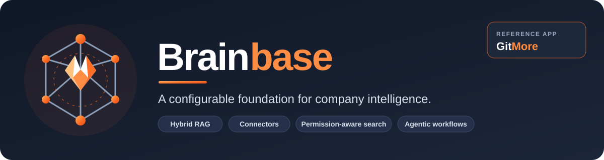
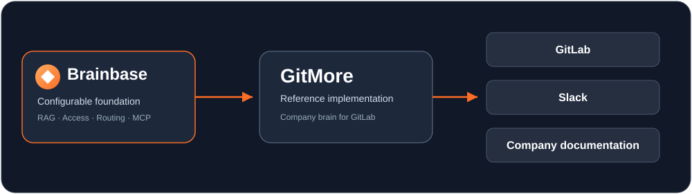
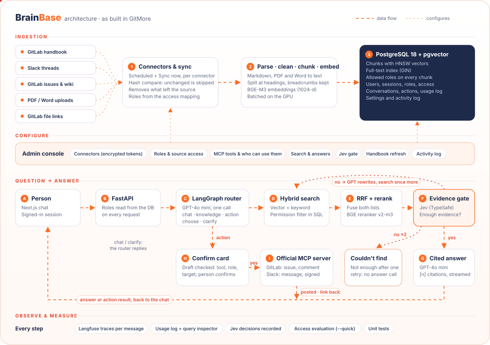
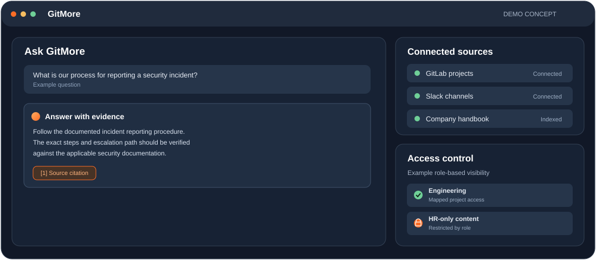

<div align="center">



<br/>

<p>
  <strong>A configurable foundation for company intelligence.</strong><br>
  Connect company knowledge. Retrieve with evidence. Respect permissions. Enable AI-powered workflows.
</p>

<p>
  <a href="#meet-gitmore">Explore GitMore</a> ·
  <a href="#architecture">Architecture</a> ·
  <a href="#run-locally">Run locally</a>
</p>

<p>
  
  
  
  
  
</p>

</div>

---

## The problem

Company knowledge rarely lives in one place. It is spread across repositories, handbooks, issue trackers, chat threads, documents, and internal tools.

People waste time searching, repeat questions, and struggle to tell which source is authoritative. A unified assistant introduces another challenge: **it must never expose information a person is not allowed to see.**

## The idea

**Brainbase is a configurable foundation for building company-specific AI brains.**

Rather than hardcoding one assistant for one organization, Brainbase is designed around configurable sources, indexing and retrieval, model settings, workflow routing, roles, access mappings, and external tools.

- **Connect:** bring knowledge together from organizational tools.
- **Retrieve:** combine semantic and keyword search, then rerank evidence.
- **Answer:** generate grounded responses with citations.
- **Respect access:** filter restricted content before it reaches the language model.
- **Act:** route requests to tools through controlled, auditable workflows.
- **Measure:** inspect traces and evaluate retrieval and answer quality.

The aim is bigger than a chatbot: one configurable foundation that can support different company-brain implementations.

## Meet GitMore

<a id="meet-gitmore"></a>

**GitMore is Brainbase's reference implementation**: a company brain for the GitLab ecosystem.

It demonstrates how a company-specific experience can bring together GitLab projects and issues, Slack conversations, and company documentation through one interface. Synthetic internal content is used to demonstrate confidential information, role restrictions, and conflicting answers.

<div align="center">



</div>

### What GitMore demonstrates

- A chat interface with clickable source citations.
- Handbook ingestion, hybrid retrieval, reciprocal rank fusion, and reranking.
- User authentication and database-backed roles.
- Source-level access mappings for GitLab projects and Slack channels.
- Configurable connector settings and encrypted connector credentials.
- Manual and scheduled synchronization, plus event-handling infrastructure.
- An admin console for users, roles, access requests, connectors, and activity logs.
- Tracing and a repeatable evaluation script for retrieval and answer quality.

GitMore is an example configuration—not the boundary of Brainbase's intended scope.

## Architecture

Brainbase has two main paths: **ingestion**, which prepares and updates the knowledge index, and **query execution**, which processes a user's request.

<a id="architecture"></a>

<div align="center">



</div>

### 1. Configure sources and access

Administrators configure connector credentials, synchronization, roles, source-level access mappings, and MCP tool settings. Connector credentials are encrypted at rest.

### 2. Ingest and index

Content is parsed, cleaned, split into meaningful chunks, enriched with metadata, embedded, and stored in PostgreSQL with pgvector and full-text search. Synchronization updates changed content and removes content that no longer exists in a source.

### 3. Retrieve evidence

The query path combines vector and keyword search, merges candidate lists using reciprocal rank fusion (RRF), and reranks results to prioritize relevant evidence. Access restrictions are applied in the retrieval query before content is passed to the language model.

### 4. Generate grounded answers

The language model answers from retrieved context and provides source citations. The intended behavior is to surface missing evidence and source conflicts rather than present unsupported guesses as facts.

### 5. Route and act

LangGraph provides the orchestration layer for multi-step workflows. The intended routing model covers knowledge retrieval, authorized live lookups, tool actions, and clarification. MCP enables standardized tool integration; write operations should require authorization, user confirmation, and audit logging.

## Demo

The visuals below illustrate the product flow. Replace them with real screenshots or a short screen recording as you polish the UI.

<div align="center">



</div>

### Suggested walkthrough

1. Ask a question about a company policy or engineering process.
2. Inspect the cited sources and open the original document or issue.
3. Sign in as a different demo user and compare what information is visible.
4. Open the connector settings to inspect synchronization and source access.
5. Review the admin console and activity log.

> **Demo environment:** GitMore is an unofficial learning/reference implementation. GitLab handbook content is public content; synthetic internal records are used for confidential-data and permission demonstrations. Do not enter real secrets or private company data into a public demo.

## Engineering highlights

### Retrieval quality

The current pipeline uses BGE-M3 embeddings, hybrid vector and keyword search, reciprocal rank fusion, and BGE Reranker v2-m3.

Initial evaluation baseline:

| Metric | Baseline |
|---|---:|
| Retrieval hit@5 | 9/9 |
| Mean reciprocal rank (MRR) | 0.81 |
| Questions with citations | 9/9 |
| Correct answers by manual review | 8/10 |
| No-answer test | 1/1 |

These results are from the initial evaluation set, not a comprehensive benchmark. They serve as a baseline for further improvements.

### Permission-aware retrieval

- Role definitions are stored in the database.
- Source access mappings control which roles can read each project or channel.
- Newly discovered sources are denied to ordinary users until access is mapped.
- Retrieval filters restricted chunks before they reach the model.

Permission correctness is a critical system requirement and should be validated continuously with cross-role tests.

### Synchronization and freshness

- Manual and scheduled synchronization.
- Per-connector locking and change-aware upserts.
- Deletion handling to remove content that disappears from a source.
- Slack event-handling and GitLab webhook infrastructure for faster updates.
- A scheduled sync as a safety net for missed events.

Near-real-time behavior depends on completing the relevant external app configuration and making webhook endpoints reachable.

### Security and observability

- Password hashes stored with bcrypt.
- JWT session delivered through an HTTP-only cookie.
- Connector tokens encrypted in the database using Fernet.
- Secret material supplied through environment configuration.
- Langfuse tracing for model and retrieval activity, including token usage, cost, and latency.
- Evaluation scripts for retrieval metrics, citation presence, no-answer behavior, and model-assisted answer grading.

## Technology stack

| Layer | Technology | Role |
|---|---|---|
| Frontend | Next.js, TypeScript, Tailwind CSS | Chat and admin experience |
| API | Python, FastAPI | Application endpoints |
| Orchestration | LangGraph | Workflow execution |
| LLM | GPT-4o mini via OpenAI SDK | Answer generation |
| Embeddings | BGE-M3 | Local embedding generation |
| Reranker | BGE Reranker v2-m3 | Relevance ranking |
| Database | PostgreSQL 18, pgvector 0.8.7 | Vectors, full-text search, metadata, users |
| Connectors | GitLab API, Slack API | Content and metadata synchronization |
| Tool integration | MCP | Standardized external tool interfaces |
| Observability | Langfuse | Tracing and model-call metrics |
| Local infrastructure | Docker Compose | Database and supporting services |

## Run locally

Brainbase is a local development project. The repository contains a Docker Compose database setup, a Python backend, and a Next.js frontend.

### Prerequisites

- Git
- Docker Desktop with virtualization enabled
- Python compatible with the backend dependencies
- Node.js and npm compatible with the frontend
- An OpenAI API key for answer generation
- GitLab and Slack credentials if you want to test those connectors

### 1. Clone the repository

```bash
git clone https://github.com/<your-github-username>/brainbase.git
cd brainbase
```

### 2. Configure environment variables

```bash
cp .env.example .env
```

Open `.env` and fill in the required values. Use the repository's `.env.example` as the source of truth for variable names and required settings.

Keep API keys, connector tokens, JWT secrets, and encryption keys out of Git. Never commit your `.env` file.

### 3. Start PostgreSQL and pgvector

```bash
docker compose up -d
```

Wait for the database health check to pass, then apply the schema using the repository's documented migration or initialization flow. The Compose setup uses PostgreSQL with pgvector.

### 4. Set up the Python backend

Create and activate a virtual environment from the repository root:

```bash
python -m venv .venv
```

Windows PowerShell:

```powershell
.\.venv\Scripts\Activate.ps1
```

macOS/Linux:

```bash
source .venv/bin/activate
```

Install the backend dependencies using the appropriate requirements file for your environment. The project separates common dependencies from GPU and CPU-specific requirements; choose the matching setup described in the repository.

Start the FastAPI application using the project's backend instructions. The API's interactive documentation is available at:

`http://localhost:8000/docs`

### 5. Set up the frontend

In a separate terminal:

```bash
cd frontend
npm install
npm run dev
```

Open the local URL printed by Next.js in your terminal.

### 6. Connect data sources

Configure GitLab and Slack credentials through the application and map the relevant projects and channels to roles. The connector experience depends on valid credentials and the corresponding external app configuration.

**Note:** Exact environment variable names, migration commands, and backend startup commands can change as the project evolves. Follow the repository's scripts and environment template rather than copying credentials or configuration from screenshots.

## Design principles

- **Configurable over hardcoded:** organization-specific settings should be expressed through configuration wherever practical.
- **Evidence over guesses:** answers should be grounded in sources and acknowledge missing evidence.
- **Permissions before generation:** restricted content must be filtered before it reaches the model.
- **Actions with accountability:** external write operations should be authorized, confirmed, and recorded.
- **Measure before optimizing:** retrieval and routing improvements should be evaluated against repeatable test sets.
- **Build incrementally:** keep the system understandable while expanding its capabilities.

---

<div align="center">

### Brainbase

**A foundation for building company brains.**

Built by **Shreya Mhetre**

<sub>Brainbase is an independent project. GitMore is an unofficial reference implementation and is not affiliated with or endorsed by GitLab.</sub>

</div>
